## Plan

### Quatre temps

1. **Les données** — 48 antibiotiques, un seul génome, un problème de choix.
2. **De 48 à 1** — couverture, prévalence, critères d'éligibilité.
3. **Exploration détaillée** — ciprofloxacine : modèles, seuil, SHAP, deep learning.
4. **Passage à l'échelle** — 8 antibiotiques, et ce que le classement raconte.

> Une seule question : à quelles conditions un modèle de résistance est-il **utile** ?

::: {.notes}
La présentation part du cas de référence — la ciprofloxacine, décrite par un mécanisme connu — puis élargit au jeu 48 antibiotiques avec `all_antibiotic.ipynb`. L'ordre est important : le choix de la cible est déjà une décision scientifique.
:::

## Contexte

### Un problème de santé publique

- La résistance aux antimicrobiens est associée à **≈ 5 millions de décès par an**, dont **1,3 million** directement attribuables (2019).
- *Escherichia coli* : pathogène majeur, porteur de nombreux mécanismes de résistance.
- L'**antibiogramme** demande 24 à 72 h ; le **séquençage** du génome prend quelques heures.

### L'idée

> Prédire le phénotype **sensible / résistant** à partir du génotype, assez tôt pour orienter le traitement.

### Mais…

- Tous les antibiotiques ne se valent pas : ni par le nombre de cas, ni par la biologie de leur résistance.
- Un bon score sur un antibiotique facile ne dit rien sur les autres.

::: {.notes}
Le projet ne cherche pas seulement à maximiser une accuracy. Il pose trois questions : quelles cibles sont exploitables, quel modèle suffit, et quel signal biologique le modèle utilise réellement.
:::

## Les données

### Un jeu *E. coli* × 48 antibiotiques

| Élément | Valeur |
|---|---:|
| Génomes | **6 949** |
| Features binaires (pangénome + variants) | **34 744** |
| Antibiotiques | **48** |
| Splits train / val / test | **4 722 / 1 110 / 1 117** |

### La cible

- `1` = résistant, `0` = sensible, `NA` = non testé.
- Chaque antibiotique n'est observé que sur une **partie** des génomes.
- Conséquence : chaque ATB a ses propres effectifs et sa propre prévalence.

::: {.notes}
Les 34 744 features décrivent la présence/absence de gènes et de variants. Le jeu est multi-label : une matrice X commune, 48 colonnes de phénotypes. Le masque d'observation est essentiel : un génome non testé pour un ATB ne doit pas être compté comme sensible.
:::

## Splits : éviter la fuite de lignage {.small}

### Le piège

- Un split aléatoire place des **clones proches** dans le train et le test.
- Le modèle apprend des **marqueurs de lignée** plutôt que la résistance.

### Le protocole

- `StratifiedGroupKFold` à **6 folds**, groupes = **lignée** (MLST).
- 4 folds train / 1 validation / 1 test.
- Aucune lignée connue dans deux splits ; lignées inconnues = groupes individuels.
- Stratification sur la **charge de résistance** (multi-label), pas sur un seul ATB.

### Ce que cela change

- Estimation **honnête** de la généralisation à des lignées non vues.
- Mais effectifs par ATB plus petits → métriques adaptées au déséquilibre.

::: {.notes}
Sans split groupé, les scores sont gonflés par la proximité génétique. Le split est construit une fois, puis réutilisé pour tous les antibiotiques : c'est ce qui rend les comparaisons valides.
:::

## Le vrai problème : 48 antibiotiques, mais combien d'exploitables ?

::: {.columns}
::: {.column width="57%"}
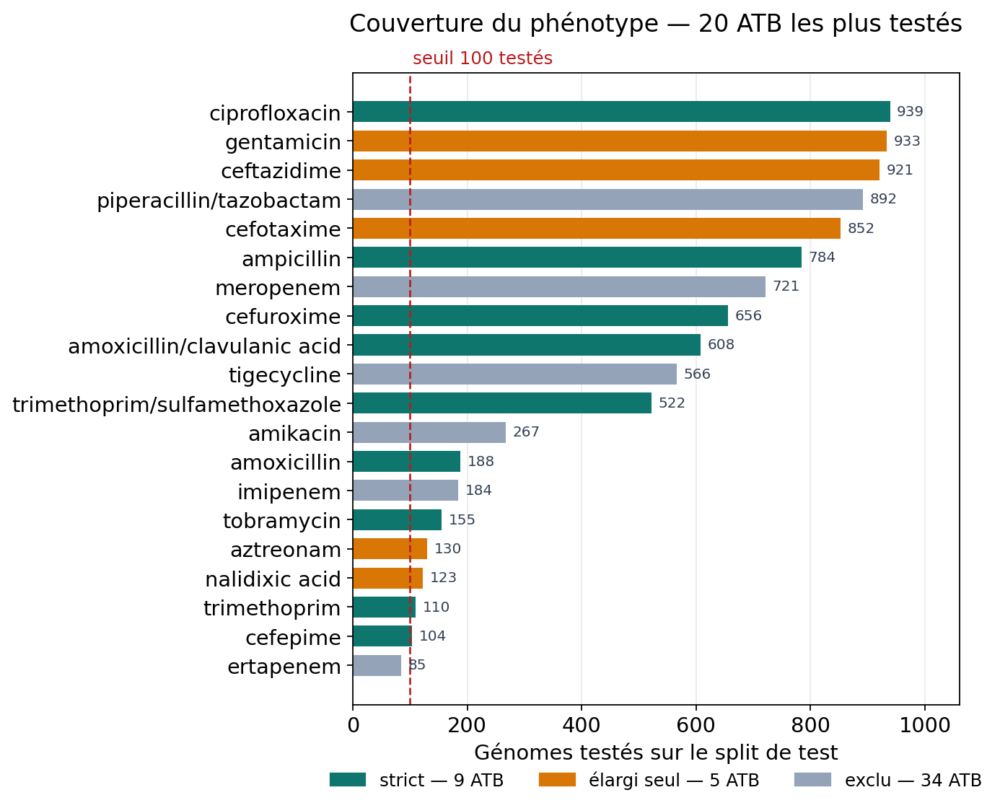{width=100%}
:::
::: {.column width="43%"}
### Deux filtres

1. **Couverture** : au moins **100 génomes testés** sur *chaque* split.
2. **Prévalence** : classe minoritaire **≥ 10 %** (strict) ou **≥ 5 %** (élargi).

### Résultat

- **9 ATB stricts**
- **14 ATB élargis**
- **34 ATB exclus**

Seuls **14 ATB sur 48** sont exploitables : c'est un manque de **données**, pas de modèle.
:::
:::

::: {.notes}
Le graphique montre les 20 ATB les plus testés. Les barres bleu-vert sont les 9 ATB stricts, les orange les 5 ATB supplémentaires du critère élargi. Beaucoup d'antibiotiques ont moins de 50 génomes testés : aucun modèle ne peut apprendre sérieusement avec si peu de positifs.
:::

## Pourquoi 34 antibiotiques sont écartés

### Les deux causes, chiffrées

| Filtre | Règle | ATB écartés |
|---|---|---:|
| Couverture | ≥ 100 testés sur train, val et test | **29** |
| Prévalence | minorité ≥ 5 % sur les 3 splits | **5** |
| **Total** | | **34** |

### Exemples

- **Trop peu de testés** : cefoxitine (74), ceftriaxone (46), lévofloxacine (28).
- **Quasi monomorphes** : méropénème (0,6 % de R), tigécycline (0,0 %), pipéracilline/tazobactam (3,6 %).

### Le point important

- Un ATB avec 0,6 % de résistants fournit **trop peu de positifs** pour apprendre et évaluer.
- Ce n'est pas un échec du modèle : c'est une **limite du jeu de données**.

::: {.notes}
Les 5 ATB écartés pour prévalence ont pourtant des effectifs confortables (184 à 892 testés). C'est bien le nombre de résistants qui manque. Il faut le dire clairement : on ne peut pas prédire ce qu'on n'a presque jamais observé.
:::

## Deux notebooks, deux rôles

### Cas de référence — ciprofloxacine

- `notebooks/ciprofloxacine_exploration.ipynb`
- **5 935 isolats × 20 929 features** : 20 731 gènes/clusters + 198 SNP QRDR.
- Splits dédiés `data/splits_snp_3way/`.

### Passage à l'échelle — 48 antibiotiques

- `notebooks/all_antibiotic.ipynb`
- **6 949 génomes × 34 744 features**.
- Une cellule change l'antibiotique ; la céfuroxime sert de cas médian.

> Deux matrices, deux granularités : les scores ne sont pas comparables au point près.

::: {.notes}
La ciprofloxacine est le cas de référence : son mécanisme est bien décrit, donc on peut juger le modèle sur autre chose que le score. Le pipeline 48 ATB utilise une autre matrice, plus large, avec ses propres variants, ses propres splits et ses propres hyperparamètres. C'est pour cela que la cipro atteint 0,951 dans le notebook dédié et 0,98 dans le run 48 ATB : deux jeux, deux estimations.
:::

## Le cas d'étude : ciprofloxacine

### La fluoroquinolone de référence

| Split | Génomes | Résistants | Prévalence |
|---|---:|---:|---:|
| Train | 4 074 | 975 | 23,9 % |
| Validation | 932 | 156 | 16,7 % |
| Test | 929 | 154 | 16,6 % |

### Pourquoi cette cible ?

- **1 285 résistants** sur 5 935 isolats (21,7 %).
- Résistance largement portée par des **mutations QRDR** connues (`gyrA`, `parC`, `parE`).
- Un **signal fort** : PR-AUC test **0,951** (0,98 dans le pipeline 48 ATB).
- Un cas **facile** : il fixe la référence à laquelle comparer les autres ATB.

::: {.notes}
La ciprofloxacine n'est pas la cible la plus difficile : c'est justement son intérêt. Si un modèle simple retrouve les mutations connues, on peut vérifier qu'il apprend la biologie et non un marqueur de lignée. La céfuroxime, plus médiane, servira de point de comparaison dans le passage à l'échelle. Les chiffres viennent du notebook `ciprofloxacine_exploration.ipynb`.
:::

## Protocole d'évaluation

### Cinq modèles, mêmes données

| Modèle | Rôle |
|---|---|
| Régression logistique | baseline linéaire |
| Régression logistique **L1** | baseline + sélection de variables |
| Random Forest | non-linéaire, bagging |
| **XGBoost** | référence sur données tabulaires |
| MLP PyTorch | baseline deep learning |

### Métriques

- **PR-AUC** : métrique principale, adaptée aux classes rares.
- **F1**, **recall résistant**, **balanced accuracy**, **calibration**.
- Comparaison à **0,5**, puis seuil **F1 max sur la validation**, appliqué une fois au test.

::: {.notes}
Avec 16,7 % de résistants, un modèle qui prédit toujours "sensible" atteint déjà 83,3 % d'accuracy. D'où le choix du PR-AUC et du recall. Le seuil est choisi sur la validation, jamais sur le test : c'est la règle du jeu.
:::

## Validation : les modèles classiques {.small}

::: {.columns}
::: {.column width="60%"}
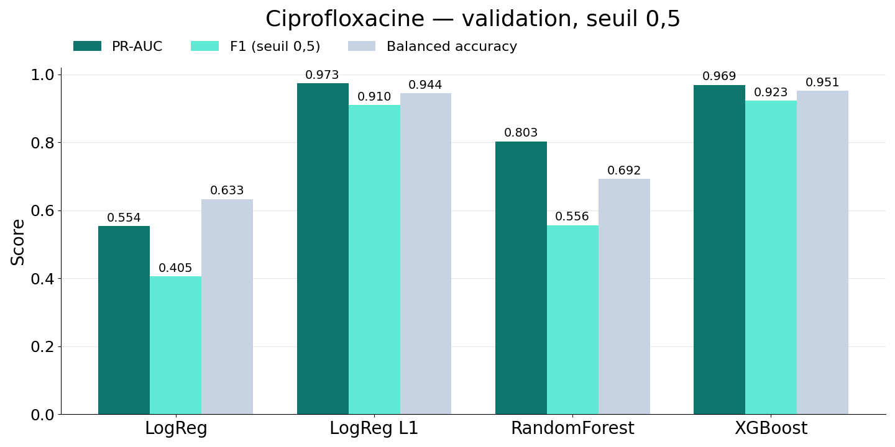{width=100%}
:::
::: {.column width="40%"}
### Lecture

- **LogReg L1** : PR-AUC **0,973** avec seulement **68 variables**.
- **XGBoost** : PR-AUC 0,969 et meilleur F1 (**0,923**).
- **Random Forest** : PR-AUC 0,803 mais **recall 0,385** → rate 6 résistants sur 10.
- **LogReg** : 0,554, sous-ajuste.
- Hasard (prévalence) : **0,167**.

> Deux modèles au coude à coude : XGBoost et une L1 de 68 variables.
:::
:::

::: {.notes}
Le Random Forest illustre le piège du déséquilibre : une précision de 1,00 peut cacher un rappel de 38 %. Pour un test de résistance, rater un résistant est généralement plus grave que sur-prédire une résistance. La L1 égale XGBoost avec 0,32 % des features : c'est le résultat le plus interprétable du projet.
:::

## L1 : combien de variables suffisent ?

::: {.columns}
::: {.column width="60%"}
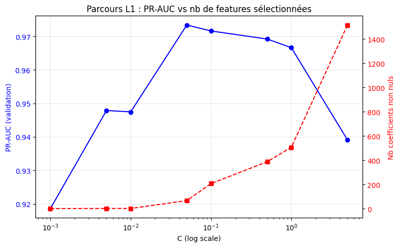{width=100%}
:::
::: {.column width="40%"}
### Le parcours

- `C = 0,001` : **2 variables**, PR-AUC **0,919** — deux mutations suffisent presque.
- **`C = 0,05` : 68 variables, PR-AUC 0,973** ← retenu.
- `C = 5` : **1 515 variables**, PR-AUC **0,939** — ajouter des features dégrade.

> **68 variables sur 20 929** (0,32 %) suffisent ; au-delà, le score baisse.
:::
:::

::: {.notes}
La courbe bleue est le PR-AUC de validation, la rouge le nombre de coefficients non nuls. Le maximum est net à 68 variables. Le point frappant est le début du parcours : deux mutations QRDR suffisent déjà à 0,919 de PR-AUC, ce qui confirme que le signal principal est biologique. Au-delà de 68 variables, on ajoute du bruit et des marqueurs de lignage.
:::

## Les variables retenues par L1

::: {.columns}
::: {.column width="55%"}
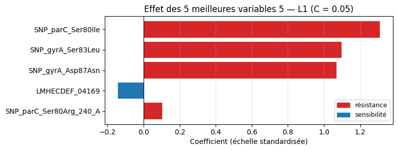{width=100%}
:::
::: {.column width="45%"}
### Lecture biologique

- `SNP_parC_Ser80Ile` **+1,31**.
- `SNP_gyrA_Ser83Leu` **+1,10**.
- `SNP_gyrA_Asp87Asn` **+1,07**.
- Les trois mutations QRDR portent **64 %** de la masse des coefficients.
- 37 coefficients positifs, 31 négatifs ; le reste est ≤ 0,15 en valeur absolue.
:::
:::

> Signal **spécifique** : contrairement à la céfuroxime, les premières variables sont le mécanisme même de la fluoroquinolone.

::: {.notes}
C'est la validation biologique du modèle. Les trois mutations QRDR dominent très largement les 68 coefficients. Les variables suivantes sont des gènes ou clusters de fonction inconnue, avec des coefficients dix fois plus petits. Sur la céfuroxime, les mêmes mutations apparaissaient alors qu'elles ne confèrent pas la résistance aux bêta-lactamines : c'était de la co-résistance. Ici, le modèle apprend bien le mécanisme de la cible.
:::

## Du score à la décision : choisir le seuil {.small}

::: {.columns}
::: {.column width="55%"}
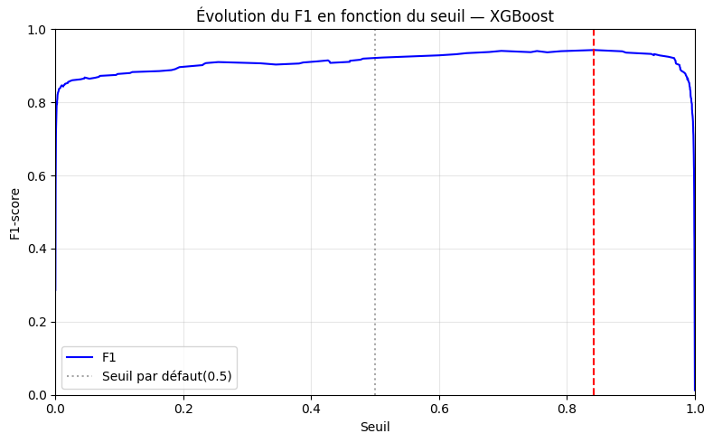{width=100%}
:::
::: {.column width="45%"}
### XGBoost — validation

- Seuil F1 max : **0,842**.
- Plateau large : F1 ≈ **0,92–0,94** entre **0,4 et 0,9**.
- À 0,5, F1 = 0,923 : le gain du seuil optimal est **marginal**.

### Pourquoi ce seuil ?

- Probabilités **polarisées** ; calibration légèrement **optimiste**.
- Seuil choisi et mesuré sur la validation → estimation **optimiste**.
- Appliqué une seule fois au test, sans retouche.
:::
:::

::: {.notes}
Le seuil 0,5 n'a rien de sacré, mais ici le déplacer change peu le F1 : entre 0,4 et 0,95, la courbe reste plate. XGBoost produit des scores très tranchés, donc la décision est robuste au seuil exact. On garde 0,842 par cohérence avec la procédure, pas parce que 0,5 serait mauvais.
:::

## Calibration des probabilités

::: {.columns}
::: {.column width="42%"}
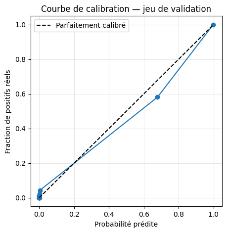{width=100%}
:::
::: {.column width="58%"}
### Lecture

- Courbe proche de la diagonale : calibration **globalement bonne**.
- Entre 0,4 et 0,8, les points sont **sous** la diagonale → modèle légèrement **optimiste**.
- Une probabilité prédite de 0,67 correspond à ≈ 0,58 de positifs réels.

### Ce que cela implique

- Le seuil élevé (0,842) reste cohérent avec des scores polarisés.
- Pour un usage clinique, il faudrait **recalibrer** (Platt / isotonic) avant de donner une probabilité.

::: {.notes}
La calibration ne change pas le classement des individus, donc pas le PR-AUC. Elle change l'interprétation des probabilités et le seuil de décision. Ici, la calibration est bien meilleure que sur la céfuroxime : le modèle est légèrement optimiste, pas franchement sous-confiant.
:::
:::
:::

## Évaluation finale sur le test {.small}

### XGBoost, seuil 0,842 (figé sur la validation)

| Accuracy | Bal. acc | Precision | Recall R | F1 R | ROC-AUC | PR-AUC |
|---:|---:|---:|---:|---:|---:|---:|
| 0,981 | 0,952 | 0,972 | 0,909 | 0,940 | 0,972 | **0,951** |

### Matrice de confusion (929 génomes)

| | Prédit sensible | Prédit résistant |
|---|---:|---:|
| **Sensible** | 771 | 4 |
| **Résistant** | 14 | 140 |

### Lecture

- **91 %** des résistants détectés ; **14 résistants manqués**.
- Précision 97 % : **4 faux positifs** seulement.
- PR-AUC **0,951** contre **0,166** au hasard → signal fort, mais 14 erreurs restent.

::: {.notes}
Le test contient 154 résistants : chaque erreur pèse lourd. Les intervalles de confiance sont larges, il ne faut pas surinterpréter un écart de 2 points avec un autre modèle. Le message : le modèle est utile comme aide, pas comme remplacement de l'antibiogramme. Les 14 faux négatifs sont analysés plus loin.
:::

## Interprétabilité globale : SHAP

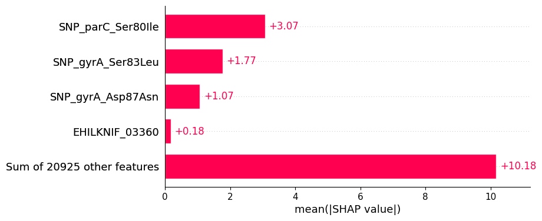{width=100%}

- `parC_Ser80Ile` : **+3,07** de |SHAP| moyen.
- `gyrA_Ser83Leu` : +1,77 ; `gyrA_Asp87Asn` : +1,07.
- Les trois mutations = **36 %** de l'attribution totale.
- Les 20 925 autres features se partagent 10,18 : signal résiduel **diffus**.

> Utile **et** spécifique : le modèle s'appuie d'abord sur le mécanisme connu.

::: {.notes}
Le graphique SHAP donne la contribution moyenne de chaque variable. Les trois mutations QRDR concentrent 36 % de l'attribution totale, contre 12 % pour les dix premières variables de la céfuroxime. C'est la différence entre un modèle qui apprend le mécanisme de la cible et un modèle qui apprend la co-résistance. Le résidu de 10,18 montre cependant que beaucoup d'autres features contribuent.
:::

## Faux positif : trois mutations, phénotype sensible {.small}

::: {.columns}
::: {.column width="62%"}
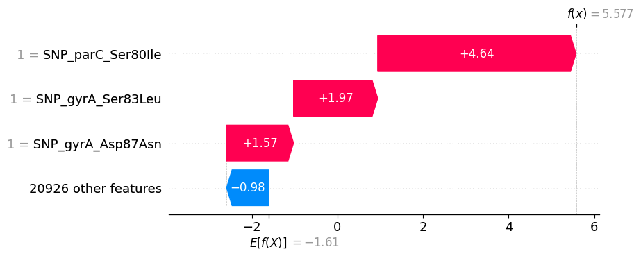{width=100%}
:::
::: {.column width="38%"}
### Prédit R, réellement S

- Score `f(x) = 5,58` → probabilité **0,996** (> seuil 0,842).
- `parC_Ser80Ile` +4,64, `gyrA_Ser83Leu` +1,97, `gyrA_Asp87Asn` +1,57.
- Les **trois mutations canoniques** sont présentes, mais le phénotype est **sensible** : erreur d'annotation, fond génétique ou cas particulier.
:::
:::

> Le modèle suit le mécanisme ; c'est le **phénotype** qui surprend.

::: {.notes}
Le waterfall SHAP explique la prédiction pour un génome précis. Ici, les trois mutations canoniques poussent le score très haut, alors que la bactérie est annotée sensible. Contrairement au faux positif de la céfuroxime, ce n'est pas de la co-résistance : le modèle applique exactement la règle biologique attendue. L'erreur pointe donc une limite des données phénotypiques, ou un cas rare de résistance non exprimée.
:::

## Faux négatif : un mécanisme absent de la matrice {.small}

::: {.columns}
::: {.column width="62%"}
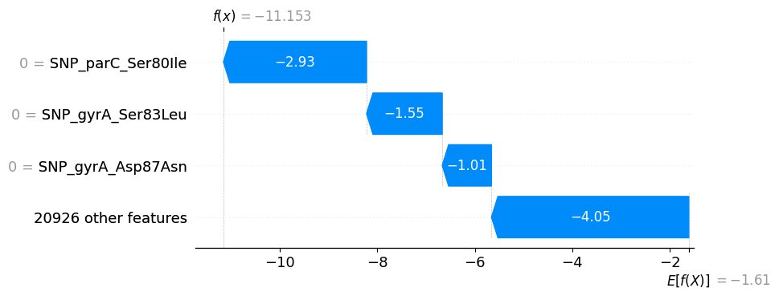{width=100%}
:::
::: {.column width="38%"}
### Prédit S, réellement R

- Score très bas : `f(x) = −11,15` → probabilité ≈ **1,4 × 10⁻⁵**.
- Aucune mutation QRDR : `parC`, `gyrA_Ser83Leu`, `gyrA_Asp87Asn` = 0.
- Les autres features pèsent −4,05 : rien ne signale la résistance.
- Mécanisme probablement **hors représentation** : `qnr`, `aac(6')-Ib-cr`, efflux, porines.
:::
:::

> Les faux négatifs révèlent les **limites de la représentation**.

::: {.notes}
Le second waterfall montre l'inverse : un génome résistant que le modèle croit profondément sensible. Rien dans les features ne signale la résistance. C'est un angle mort de la matrice : le pangénome et les 198 SNP QRDR ne capturent ni les variants plasmidiques non assemblés, ni l'expression des pompes d'efflux, ni les mécanismes régulateurs. Le modèle ne peut pas inventer un signal qu'il n'a jamais vu.
:::

## Deep learning : MLP sur les 20 929 features {.small}

::: {.columns}
::: {.column width="62%"}
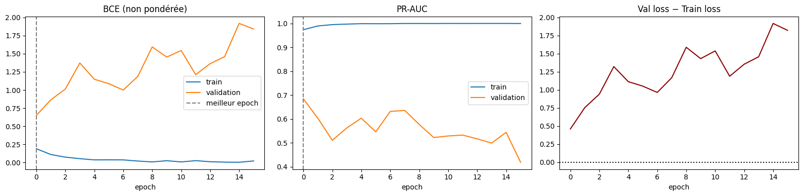{width=100%}
:::
::: {.column width="38%"}
### Architecture

- `20 929 → 512 → 128 → 32 → 1` ; BatchNorm, dropout 0,3 / 0,2.
- AdamW, `pos_weight ≈ 3,18`, early stopping (patience 15).

### Entraînement

- Meilleur epoch : **0** (PR-AUC val **0,685**), arrêt à 15 ; la loss de validation **diverge**.
- Test (seuil 0,776) : PR-AUC **0,730** · F1 **0,701** · recall **0,714**.
:::
:::

::: {.notes}
Le point frappant : le meilleur epoch est le premier. Le réseau mémorise immédiatement les 4 074 génomes d'entraînement, puis se dégrade. Ce n'est pas seulement du sur-apprentissage classique : l'optimisation elle-même est instable sur cette matrice très creuse et très large.
:::

## MLP avec sélection de variables (top 50 SHAP) {.small}

::: {.columns}
::: {.column width="62%"}
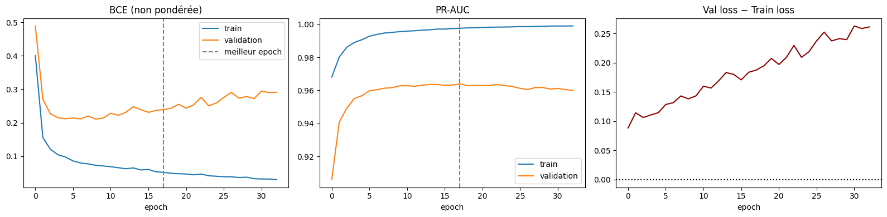{width=100%}
:::
::: {.column width="38%"}
### Protocole

- Top 50 features par **|SHAP| moyen** (1 000 génomes).
- `50 → 64 → 16 → 1`, dropout 0,5.

### Résultats

- Meilleur epoch : **17** (PR-AUC val **0,964**), arrêt à 32.
- Test (seuil 0,960) : PR-AUC **0,954** · F1 **0,943** · bal. acc **0,953**.

### Lecture

- Égalise XGBoost (**0,954 vs 0,951**), mais **après** sélection SHAP par XGBoost.
:::
:::

::: {.notes}
Réduire à 50 features stabilise l'entraînement : le meilleur epoch passe de 0 à 17. Le MLP égale alors XGBoost, ce qui confirme le diagnostic : le problème n'est pas la capacité du réseau, mais le rapport signal/bruit de la représentation. Attention : les 50 features sont choisies par SHAP à partir de XGBoost, donc le deep learning ne montre pas un gain autonome.
:::

## Récapitulatif — ciprofloxacine, test {.small}

### Trois modèles évalués sur le test, un seuil choisi sur la validation

| Modèle | Seuil | PR-AUC | F1 | Recall R | Bal. acc |
|---|---:|---:|---:|---:|---:|
| **XGBoost** | 0,842 | 0,951 | 0,940 | 0,909 | 0,952 |
| MLP (toutes features) | 0,776 | 0,730 | 0,701 | 0,714 | 0,825 |
| MLP (top 50) | 0,960 | **0,954** | **0,943** | 0,909 | **0,953** |

*LogReg L1 : PR-AUC 0,973 en validation, non réévaluée sur le test dans le notebook.*

### Ce qu'il faut retenir

- **XGBoost** est la référence ; le MLP top-50 fait jeu égal, à **0,3 point** près.
- Le MLP complet est **22 points** en dessous du PR-AUC.
- Sur 154 résistants, ces écarts ne sont pas tous significatifs : il faut des **intervalles de confiance**.

> Le deep learning n'apporte pas de gain **autonome** sur cette matrice tabulaire.

::: {.notes}
La L1 n'est pas réévaluée sur le test dans le notebook : son 0,973 est une performance de validation. Il faut le dire pour ne pas comparer un chiffre de validation à des chiffres de test. Le message n'est pas "le DL est mauvais", mais "le DL n'est pas le bon outil pour 4 000 échantillons × 20 929 features binaires, sauf si l'on réduit d'abord la dimension".
:::

## Passage à l'échelle : 8 antibiotiques {.small}

::: {.columns}
::: {.column width="58%"}
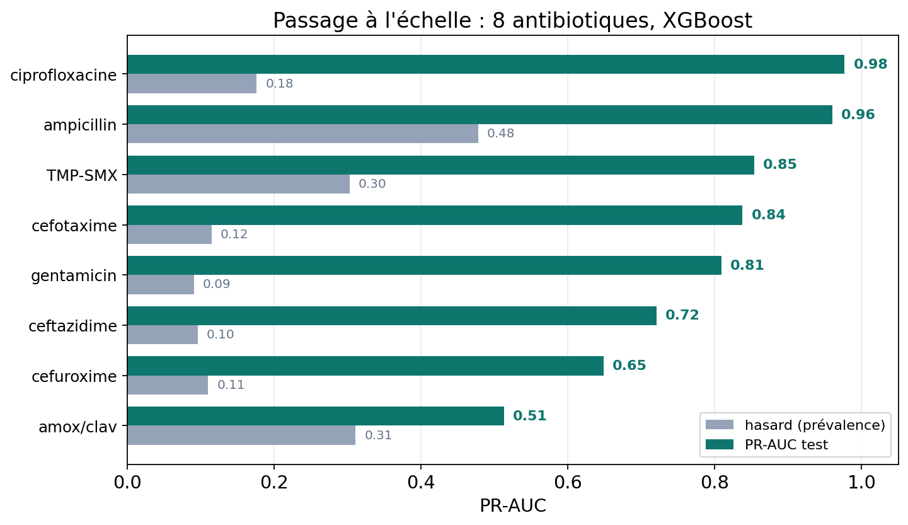{width=100%}
:::
::: {.column width="42%"}
### Le pipeline

- `run_antibiotic_pipeline(atb, data)` — mêmes modèles, même protocole.
- Un artefact `.joblib` par ATB.

### Les résultats (test)

- cipro **0,98** · ampicilline **0,96** · TMP-SMX **0,85**
- cefotaxime **0,84** · gentamicine **0,81** · ceftazidime **0,72**
- cefuroxime **0,65** · amox/clav **0,51**
- Tous au-dessus du hasard, gains **très inégaux**.
:::
:::

::: {.notes}
Ce run de référence couvre 8 ATB. Le notebook permet de relancer la boucle sur les 9 ATB stricts. La cipro y atteint 0,98 (pipeline 34 744 features) contre 0,951 dans le notebook dédié (20 929 features) : deux matrices et deux splits, donc deux estimations, à lire comme ±0,02. Les écarts avec l'exploration manuelle de céfuroxime (0,649 vs 0,665) viennent des hyperparamètres propres au pipeline et du seuil.
:::

## Ce que le classement nous apprend

### La performance suit la biologie de la résistance

- **Facile** : mutations ponctuelles ciblées — fluoroquinolones, ampicilline → **0,95–0,98**.
- **Moyen** : bêta-lactamines à spectre étendu, aminoglycosides → **0,72–0,85**.
- **Difficile** : amoxicilline/acide clavulanique → **0,51**, à peine mieux que le hasard (0,31).

### La prévalence n'explique pas tout

- Amox/clav : **31 %** de résistants, mais un PR-AUC de 0,51.
- Ciprofloxacine : **18 %** de résistants, PR-AUC de **0,95–0,98** selon le pipeline.
- Ce qui change : la **génétique de la résistance** (SNP ciblés vs mécanismes multiples).

### Conséquence

> Choisir l'antibiotique n'est pas un détail technique : c'est **formuler le problème**.

::: {.notes}
C'est le résultat le plus intéressant du passage à l'échelle. On pourrait croire qu'un ATB avec beaucoup de résistants est plus facile : c'est faux. Les bêta-lactamines à large spectre combinent plusieurs mécanismes (bêta-lactamases, porines, efflux), souvent plasmidiques et mal capturés par une matrice de présence/absence.
:::

## Limites {.small}

- **Tests petits** : 929 / 154 R (cipro) ; 656 / 72 R (céfuroxime) → IC larges.
- **Deux jeux différents** : 20 929 vs 34 744 features, splits dédiés → scores non strictement comparables.
- **Split groupé par lignée**, pas par phylogénie fine.
- **Pas de validation externe** (autre cohorte, autre pays).
- **Seuil choisi et mesuré sur la validation** → estimation optimiste.
- **Calibration explorée, non corrigée** (Platt / isotonic).
- **Deep learning** : une architecture, un seed ; MLP complet = epoch 0.
- **Mécanismes manquants** : 14 faux négatifs cipro sans QRDR → `qnr`, efflux, porines.
- **Co-résistance** : sur la céfuroxime, `parC` / `gyrA` = marqueurs de lignage.
- **Phénotypes hétérogènes** entre études.

::: {.notes}
Il faut présenter ces limites avant les perspectives : elles conditionnent ce qu'on peut affirmer. En particulier, le seuil optimisé sur la validation puis appliqué au test reste une estimation optimiste tant qu'on ne fait pas de validation croisée imbriquée.
:::

## Perspectives {.small}

### Consolider la mesure

- Validation croisée groupée à 5 folds, plusieurs seeds, **bootstrap** pour les IC.
- **Validation externe** et seuil figé évalué sur le test.
- **Recalibration** (Platt / isotonic) intégrée à la décision.

### Améliorer le signal

- Modèle **multi-tâches** : partager l'information entre les 48 ATB.
- Features ciblées : **bêta-lactamases, porines, efflux**, plasmides, `qnr`, `aac(6')-Ib-cr`.
- Annotation des clusters inconnus (`EHILKNIF_03360`, `LMHECDEF_04169`…).

### Rendre l'outil utilisable

- Prédiction à partir d'un génome, avec **abstention** hors domaine de validité.
- Restituer la **probabilité calibrée** et les variables contributives, pas seulement R/S.

::: {.notes}
La piste multi-tâches est probablement la plus prometteuse : les ATB partagent des mécanismes et des lignées, donc un modèle joint peut mieux apprendre les ATB rares. C'est aussi une réponse directe au problème des 34 ATB exclus.
:::

## Conclusion

### Ce que l'on retient

- **48 ATB → 9 exploitables** en critère strict : la couverture et la prévalence sont des filtres décisifs.
- **Ciprofloxacine**, cas de référence : XGBoost atteint **0,951** de PR-AUC test, contre **0,166** au hasard.
- La **L1** retrouve **68 variables** sur 20 929 ; les trois mutations QRDR portent **64 %** de la masse des coefficients.
- Le **deep learning** complet échoue (**0,730**) ; avec les 50 features choisies par XGBoost, il égale XGBoost (**0,954**), sans gain autonome.
- La performance varie de **0,51 à 0,98** selon l'antibiotique : la cible compte autant que le modèle.

> Le bon modèle n'est pas le plus complexe : c'est celui qui capture un signal biologique réel, généralise sur des lignées non vues et sait dire **ce qu'il ne sait pas**.

::: {.notes}
La conclusion reprend les quatre temps de la présentation. Le fil rouge : un modèle utile suppose une cible bien choisie, une évaluation honnête et une interprétation biologique prudente.
:::

## Questions

### Merci de votre attention

- Cas de référence : `notebooks/ciprofloxacine_exploration.ipynb`
- Passage à l'échelle : `notebooks/all_antibiotic.ipynb`
- Pipeline : `src/pipeline.py`
- Rapports : `reports/coverage_by_atb.csv`, `reports/summary_by_atb.csv`
- Présentation générée avec **Quarto + Reveal.js**

::: {.notes}
Les figures de cette présentation sont issues directement des sorties des notebooks : couverture et sélection pour les 48 ATB, L1 / SHAP / MLP pour la ciprofloxacine, et rapports CSV du run de référence pour le passage à l'échelle.
:::
