## Plan

### Quatre temps

1. **Les données** — 48 antibiotiques, un seul génome, un problème de choix.
2. **De 48 à 1** — couverture, prévalence, critères d'éligibilité.
3. **Exploration détaillée** — cefuroxime : modèles, seuil, SHAP, deep learning.
4. **Passage à l'échelle** — 8 antibiotiques, et ce que le classement raconte.

> Une seule question : à quelles conditions un modèle de résistance est-il **utile** ?

::: {.notes}
La présentation suit le notebook `all_antibiotic.ipynb` : on commence par choisir la cible, puis on explore un antibiotique en profondeur, puis on généralise. L'ordre est important : le choix de l'antibiotique est déjà une décision scientifique.
:::

## Contexte

### Un problème de santé publique

- La résistance aux antimicrobiens est associée à **≈ 5 millions de décès par an**, dont **1,3 million** directement attribuables (2019).
- *Escherichia coli* : pathogène majeur, porteur de nombreux mécanismes de résistance.
- L'**antibiogramme** demande 24 à 72 h ; le **séquençage** du génome prend quelques heures.

### L'idée

> Prédire le phénotype **sensible / résistant** à partir du génotype, assez tôt pour orienter le traitement.

### Mais…

- Tous les antibiotiques ne se valent pas : ni par le nombre de cas, ni par la biologie de leur résistance.
- Un bon score sur un antibiotique facile ne dit rien sur les autres.

::: {.notes}
Le projet ne cherche pas seulement à maximiser une accuracy. Il pose trois questions : quelles cibles sont exploitables, quel modèle suffit, et quel signal biologique le modèle utilise réellement.
:::

## Les données

### Un jeu *E. coli* × 48 antibiotiques

| Élément | Valeur |
|---|---:|
| Génomes | **6 949** |
| Features binaires (pangénome + variants) | **34 744** |
| Antibiotiques | **48** |
| Splits train / val / test | **4 722 / 1 110 / 1 117** |

### La cible

- `1` = résistant, `0` = sensible, `NA` = non testé.
- Chaque antibiotique n'est observé que sur une **partie** des génomes.
- Conséquence : chaque ATB a ses propres effectifs et sa propre prévalence.

::: {.notes}
Les 34 744 features décrivent la présence/absence de gènes et de variants. Le jeu est multi-label : une matrice X commune, 48 colonnes de phénotypes. Le masque d'observation est essentiel : un génome non testé pour un ATB ne doit pas être compté comme sensible.
:::

## Splits : éviter la fuite de lignage

### Le piège

- Un split aléatoire place des **clones proches** dans le train et le test.
- Le modèle apprend des **marqueurs de lignée** plutôt que la résistance.

### Le protocole

- `StratifiedGroupKFold` à **6 folds**, groupes = **lignée** (MLST).
- 4 folds train / 1 validation / 1 test.
- Aucune lignée connue dans deux splits ; lignées inconnues = groupes individuels.
- Stratification sur la **charge de résistance** (multi-label), pas sur un seul ATB.

### Ce que cela change

- Estimation **honnête** de la généralisation à des lignées non vues.
- Mais effectifs par ATB plus petits → métriques adaptées au déséquilibre.

::: {.notes}
Sans split groupé, les scores sont gonflés par la proximité génétique. Le split est construit une fois, puis réutilisé pour tous les antibiotiques : c'est ce qui rend les comparaisons valides.
:::

## Le vrai problème : 48 antibiotiques, mais combien d'exploitables ?

::: {.columns}
::: {.column width="57%"}
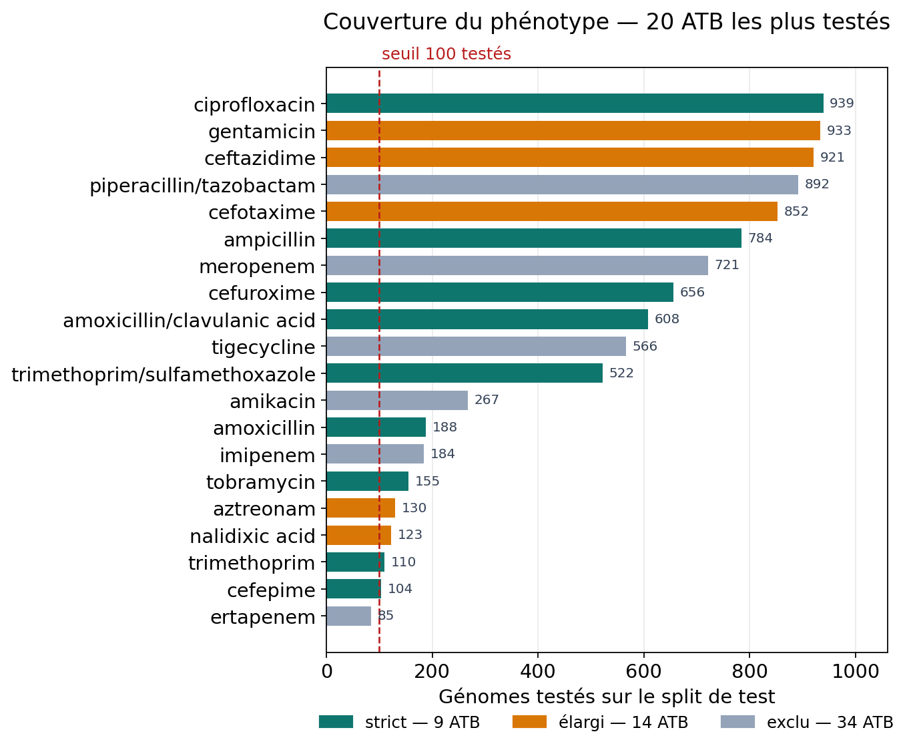{width=100%}
:::
::: {.column width="43%"}
### Deux filtres

1. **Couverture** : au moins **100 génomes testés** sur *chaque* split.
2. **Prévalence** : classe minoritaire **≥ 10 %** (strict) ou **≥ 5 %** (élargi).

### Résultat

- **9 ATB stricts**
- **14 ATB élargis**
- **34 ATB exclus**

> La moitié du jeu est inutilisable, non par manque de modèle, mais par manque de données.
:::
:::

::: {.notes}
Le graphique montre les 20 ATB les plus testés. Les barres bleu-vert sont les 9 ATB stricts, les orange les 5 ATB supplémentaires du critère élargi. Beaucoup d'antibiotiques ont moins de 50 génomes testés : aucun modèle ne peut apprendre sérieusement avec si peu de positifs.
:::

## Pourquoi 34 antibiotiques sont écartés

### Les deux causes, chiffrées

| Filtre | Règle | ATB écartés |
|---|---|---:|
| Couverture | ≥ 100 testés sur train, val et test | **29** |
| Prévalence | minorité ≥ 5 % sur les 3 splits | **5** |
| **Total** | | **34** |

### Exemples

- **Trop peu de testés** : cefoxitine (74), ceftriaxone (46), lévofloxacine (26).
- **Quasi monomorphes** : méropénème (0,6 % de R), tigécycline (0,0 %), pipéracilline/tazobactam (3,6 %).

### Le point important

- Un ATB avec 0,6 % de résistants fournit **trop peu de positifs** pour apprendre et évaluer.
- Ce n'est pas un échec du modèle : c'est une **limite du jeu de données**.

::: {.notes}
Les 5 ATB écartés pour prévalence ont pourtant des effectifs confortables (184 à 892 testés). C'est bien le nombre de résistants qui manque. Il faut le dire clairement : on ne peut pas prédire ce qu'on n'a presque jamais observé.
:::

## Le cas d'étude : cefuroxime

### Une céphalosporine de 2e génération

| Split | Génomes | Résistants | Prévalence |
|---|---:|---:|---:|
| Train | 2 676 | 382 | 14,3 % |
| Validation | 769 | 89 | 11,6 % |
| Test | 656 | 72 | 11,0 % |

### Pourquoi cette cible ?

- Effectifs **intermédiaires** : assez pour apprendre, assez petit pour que les erreurs se voient.
- Prévalence **modérée** (11 %) : le déséquilibre compte, sans rendre la tâche impossible.
- Performance **non triviale** : PR-AUC ≈ 0,66 contre **0,11** pour un modèle au hasard.
- Un bon terrain pour comparer les modèles et discuter l'interprétation.

::: {.notes}
Cefuroxime n'est pas le cas le plus facile (ciprofloxacine) ni le plus difficile (amoxicilline/acide clavulanique). C'est un cas médian, donc représentatif de ce que le pipeline doit savoir faire. Les chiffres viennent du notebook avec ATB = "cefuroxime".
:::

## Changer d'antibiotique : une seule cellule

```python
ATB = "cefuroxime"                 # la seule ligne à changer
splits_atb = pick_antibiotic(ATB)  # prépare X/y pour train, val, test
```

### Ce que la fonction garantit

- L'ATB existe dans les 48 colonnes de phénotypes.
- Il respecte les critères de sélection (sinon : **warning**, pas d'erreur).
- Les trois splits sont préparés avec les **mêmes features** et les **mêmes index**.
- Tout le reste du notebook est générique : modèles, seuil, SHAP, MLP.

```python
ATB_CIBLES = CANDIDATS_STRICT   # 9 antibiotiques
```

> Un pipeline, une cible interchangeable : les comparaisons restent valides.

::: {.notes}
C'est le coeur de la restructuration du notebook : le choix de l'ATB est isolé dans une cellule, et tout le reste s'exécute sans modification. La liste ATB_CIBLES sert ensuite à la boucle de passage à l'échelle.
:::

## Protocole d'évaluation

### Cinq modèles, mêmes données

| Modèle | Rôle |
|---|---|
| Régression logistique | baseline linéaire |
| Régression logistique **L1** | baseline + sélection de variables |
| Random Forest | non-linéaire, bagging |
| **XGBoost** | référence sur données tabulaires |
| MLP PyTorch | baseline deep learning |

### Métriques

- **PR-AUC** : métrique principale, adaptée aux classes rares.
- **F1**, **recall résistant**, **balanced accuracy**, ROC-AUC.
- **Calibration** : les probabilités sont-elles interprétables ?

### Seuil de décision

- Comparaison des modèles à **0,5**.
- Puis seuil qui **maximise le F1 sur la validation**, appliqué **une seule fois** au test.

::: {.notes}
Avec 11 % de résistants, un modèle qui prédit toujours "sensible" atteint déjà 89 % d'accuracy. D'où le choix du PR-AUC et du recall. Le seuil est choisi sur la validation, jamais sur le test : c'est la règle du jeu.
:::

## Validation : les modèles classiques {.small}

::: {.columns}
::: {.column width="60%"}
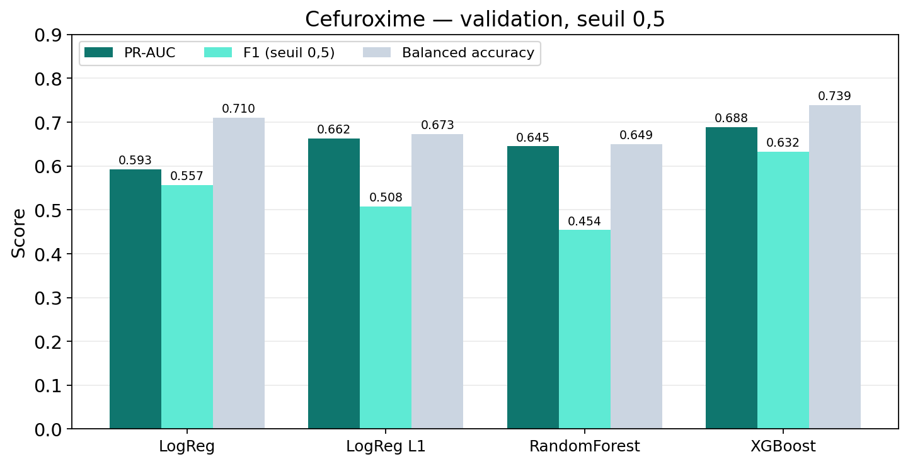{width=100%}
:::
::: {.column width="40%"}
### Lecture

- **XGBoost** : meilleur PR-AUC (**0,688**) et meilleur F1 (**0,632**).
- **LogReg L1** : PR-AUC 0,662, mais F1 0,508 — précise (0,94), donc **prudente**.
- **Random Forest** : PR-AUC 0,645 mais **recall 0,303** → rate 7 résistants sur 10.
- **LogReg** : 0,593, sous-ajuste.
- Hasard (prévalence) : **0,116**.

> Le classement dépend de la métrique : XGBoost domine, mais L1 reste compétitive.
:::
:::

::: {.notes}
Le Random Forest illustre le piège du déséquilibre : une précision de 0,90 peut cacher un rappel de 30 %. Pour un test de résistance, rater un résistant est généralement plus grave que sur-prédire une résistance.
:::

## L1 : combien de variables suffisent ?

::: {.columns}
::: {.column width="60%"}
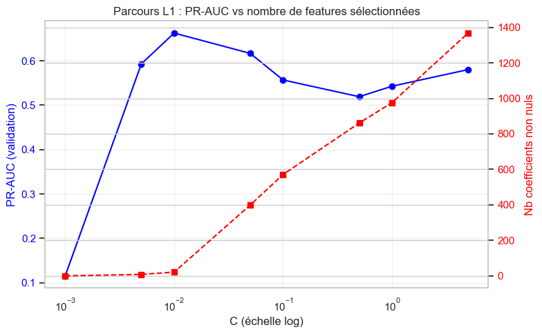{width=100%}
:::
::: {.column width="40%"}
### Le parcours

- `C = 0,001` : tous les coefficients à zéro → modèle constant, PR-AUC = hasard.
- `C = 0,005` : 1 à 2 variables, PR-AUC 0,593.
- **`C = 0,01` : 21 variables, PR-AUC 0,662** ← retenu.
- `C ≥ 0,05` : des centaines puis des milliers de variables, PR-AUC **baisse** (0,617 → 0,543).

### Message

> Le signal est **concentré** : une vingtaine de variables sur 34 744 suffisent. Ajouter des variables ajoute du bruit et des marqueurs de lignage.
:::
:::

::: {.notes}
La courbe bleue est le PR-AUC de validation, la rouge le nombre de coefficients non nuls. Le maximum est net : la sélection L1 fait mieux que le modèle complet. C'est un résultat classique en génomique, où beaucoup de features sont corrélées ou propres à une lignée.
:::

## Les variables retenues par L1

::: {.columns}
::: {.column width="53%"}
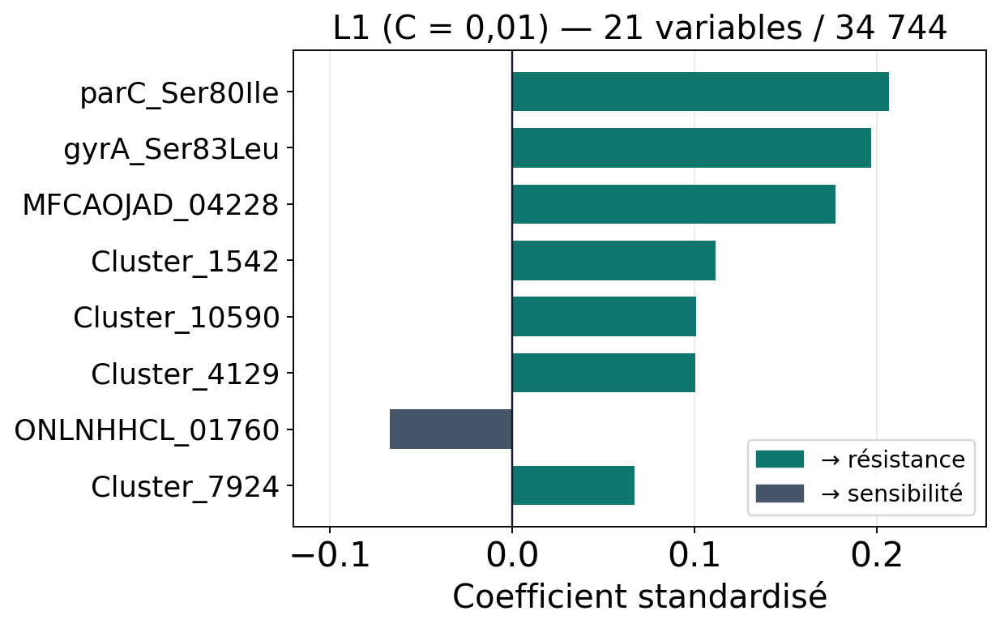{width=100%}
:::
::: {.column width="47%"}
### Lecture biologique

- `parC_Ser80Ile` et `gyrA_Ser83Leu` : mutations **QRDR** — cibles des fluoroquinolones.
- `MFCAOJAD_04228` et des clusters : fonction inconnue ou accessoire.
- 19 coefficients **positifs** (présence = signal de résistance), 2 négatifs.
:::
:::

> Pour une céphalosporine, les premières variables sont des marqueurs de **fluoroquinolones**. Le modèle apprend la **co-résistance**, pas nécessairement le mécanisme propre à cefuroxime.

::: {.notes}
C'est un point d'interprétation majeur. Les mutations parC/gyrA ne confèrent pas la résistance aux bêta-lactamines : elles signalent des clones multirésistants. Le modèle est prédictif, mais l'explication biologique est indirecte. Il faudra le garder en tête pour la partie SHAP.
:::

## Du score à la décision : choisir le seuil {.small}

::: {.columns}
::: {.column width="55%"}
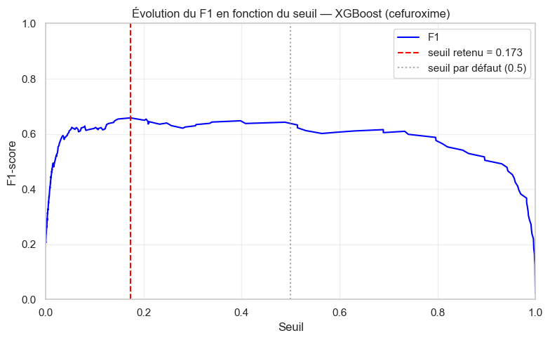{width=100%}
:::
::: {.column width="45%"}
### XGBoost — validation

- Seuil qui maximise le F1 : **0,173**.
- Le plateau est large entre **0,1 et 0,4** : le choix exact est robuste.
- À 0,5, le modèle est **trop prudent** : il rate des résistants.

### Pourquoi un seuil si bas ?

- Les probabilités sont **sous-confiantes** (voir slide suivante).
- La prévalence est faible : le modèle produit peu de probabilités élevées.

### Prudence

- Seuil choisi **et** mesuré sur la validation → estimation **optimiste**.
- Il sera appliqué une seule fois au test, sans retouche.
:::
:::

::: {.notes}
Le seuil 0,5 n'a rien de sacré : il suppose des classes équilibrées et des probabilités calibrées. Ici, descendre à 0,17 augmente le rappel sans effondrer la précision. C'est un choix de coût clinique, pas un choix statistique neutre.
:::

## Calibration des probabilités

::: {.columns}
::: {.column width="42%"}
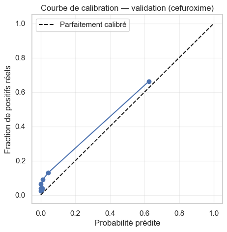{width=100%}
:::
::: {.column width="58%"}
### Lecture

- Les points sont **au-dessus de la diagonale** : le modèle **sous-estime** les probabilités.
- Une probabilité prédite de 0,6 correspond à ≈ 0,66 de positifs réels.
- La discrimination (PR-AUC) est correcte, mais l'échelle des probabilités est **conservatrice**.

### Ce que cela implique

- Un seuil à 0,5 est mécaniquement trop strict.
- Un seuil plus bas (0,17) compense la sous-confiance.
- Pour un usage clinique, il faudrait **recalibrer** (Platt / isotonic) et non seulement déplacer le seuil.

::: {.notes}
La calibration ne change pas le classement des individus, donc pas le PR-AUC. Elle change l'interprétation des probabilités et le seuil de décision. Ici, la sous-confiance est cohérente avec le déséquilibre et la régularisation.
:::
:::
:::

## Évaluation finale sur le test {.small}

### XGBoost, seuil 0,173 (figé sur la validation)

| Accuracy | Bal. acc | Precision | Recall R | F1 R | ROC-AUC | PR-AUC |
|---:|---:|---:|---:|---:|---:|---:|
| 0,927 | 0,758 | 0,722 | 0,542 | 0,619 | 0,831 | **0,665** |

### Matrice de confusion (656 génomes)

| | Prédit sensible | Prédit résistant |
|---|---:|---:|
| **Sensible** | 569 | 15 |
| **Résistant** | 33 | 39 |

### Lecture

- **54 %** des résistants détectés ; **33 résistants manqués**.
- Précision 72 % : un tiers des alertes sont des faux positifs.
- PR-AUC **0,665** contre **0,110** au hasard → le signal est réel, mais loin d'être suffisant pour décider seul.

::: {.notes}
Le test contient 72 résistants : chaque erreur pèse lourd. Les intervalles de confiance sont larges, il ne faut pas surinterpréter un écart de 2 points avec un autre modèle. Le message : le modèle est utile comme aide, pas comme remplacement de l'antibiogramme.
:::

## Interprétabilité globale : SHAP

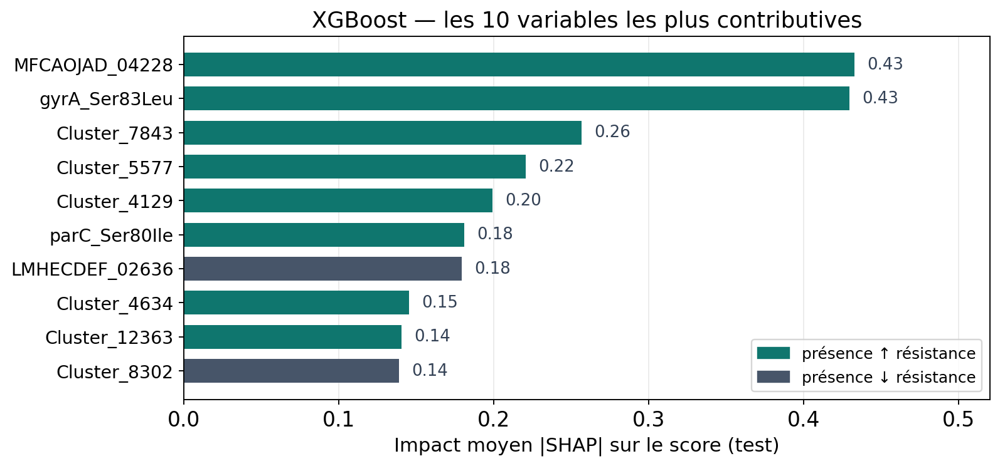{width=100%}

- La présence de `gyrA_Ser83Leu` / `parC_Ser80Ile` augmente fortement le score (+0,82 / +0,87).
- Les 10 premières variables ne totalisent que **12 %** de l'attribution SHAP totale : signal **diffus**.

> Utile ≠ spécifique : SHAP met en avant la **co-résistance**, pas le mécanisme propre à cefuroxime.

::: {.notes}
Le graphique SHAP donne la contribution de chaque variable pour chaque génome. On retrouve les marqueurs QRDR, ce qui est rassurant pour la qualité du modèle, mais suspect pour l'interprétation spécifique à cefuroxime. La somme des 34 735 autres features pèse lourd : le signal est aussi diffus.
:::

## Faux positif : la co-résistance piège le modèle

::: {.columns}
::: {.column width="62%"}
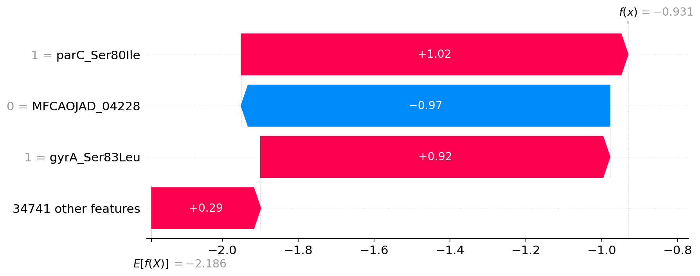{width=100%}
:::
::: {.column width="38%"}
### Prédit résistant, réellement sensible

- Score `f(x) = −0,93` → probabilité **0,28**, au-dessus du seuil 0,173.
- `parC_Ser80Ile` (+1,02) et `gyrA_Ser83Leu` (+0,92) suffisent.
- Le génome est un clone **multirésistant** (fluoroquinolones), mais sensible à cefuroxime.
- Le modèle infère une résistance par **co-résistance**, pas par mécanisme β-lactamine.
:::
:::

> Une erreur d'**inférence biologique** : la corrélation entre résistances n'est pas une causalité.

::: {.notes}
Le waterfall SHAP explique la prédiction pour un génome précis. Les deux mutations QRDR poussent le score au-dessus du seuil, alors que la bactérie est sensible à cefuroxime. C'est le risque des modèles entraînés sur des clones MDR : ils apprennent "clone résistant" plutôt que "résistance à cet antibiotique".
:::

## Faux négatif : un angle mort de la représentation

::: {.columns}
::: {.column width="62%"}
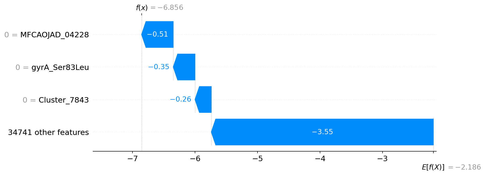{width=100%}
:::
::: {.column width="38%"}
### Prédit sensible, réellement résistant

- Score très bas : `f(x) = −6,86` → probabilité ≈ **0,001**.
- Aucun marqueur connu activé : `MFCAOJAD_04228 = 0`, `gyrA = 0`.
- Mécanisme probablement **absent des features** : β-lactamase plasmidique, porines, expression.
- Le modèle ne peut pas inventer un signal qu'il n'a jamais vu.
:::
:::

> Les faux négatifs révèlent les **limites de la représentation**, pas seulement celles du modèle.

::: {.notes}
Le second waterfall montre l'inverse : un génome résistant que le modèle croit profondément sensible. Rien dans les features ne signale la résistance. C'est un angle mort de la matrice : la présence/absence de gènes ne capture ni l'expression, ni les variants plasmidiques non assemblés, ni les mécanismes régulateurs.
:::

## Deep learning : MLP sur les 34 744 features

::: {.columns}
::: {.column width="62%"}
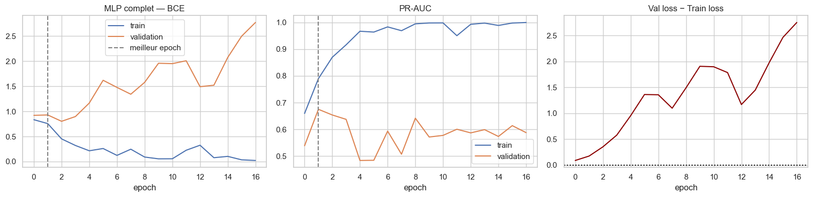{width=100%}
:::
::: {.column width="38%"}
### Architecture

- `34 744 → 512 → 128 → 32 → 1` ; BatchNorm, dropout 0,3 / 0,2.
- AdamW, `pos_weight ≈ 6`, early stopping (patience 15).

### Entraînement

- Meilleur epoch : **1** (PR-AUC val **0,675**), arrêt à 16.
- PR-AUC train → **1,0** ; la loss de validation **diverge**.

### Test (seuil 0,937)

- PR-AUC **0,623** · F1 **0,593** · recall **0,444**.
:::
:::

::: {.notes}
Le point frappant : le meilleur epoch est le premier. Le réseau mémorise immédiatement les 2 676 génomes d'entraînement, puis se dégrade. Ce n'est pas seulement du sur-apprentissage classique : l'optimisation elle-même est instable sur cette matrice très creuse et très large.
:::

## MLP avec sélection de variables (top 50 SHAP)

::: {.columns}
::: {.column width="62%"}
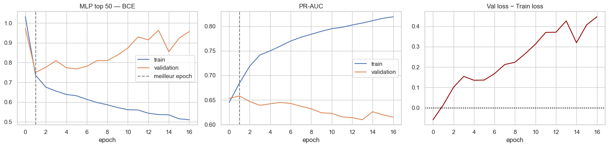{width=100%}
:::
::: {.column width="38%"}
### Protocole

- Top 50 features par **|SHAP| moyen** (1 000 génomes du train).
- `50 → 64 → 16 → 1`, dropout 0,5, même early stopping.

### Résultats

- Meilleur epoch : **1** (PR-AUC val **0,658**).
- Test (seuil 0,667) : PR-AUC **0,635** · F1 **0,623** · bal. acc **0,779**.

### Lecture

- Mieux que le MLP complet (**moins de bruit**), toujours derrière XGBoost et L1.
- Le réseau ne transforme pas un problème de features en problème d'architecture.
:::
:::

::: {.notes}
Réduire à 50 features améliore légèrement le MLP, ce qui confirme le diagnostic : le problème n'est pas la capacité du réseau, mais le rapport signal/bruit de la représentation. Un MLP plus gros ou plus long n'aurait pas aidé.
:::

## Récapitulatif — cefuroxime, test {.small}

### Quatre modèles, un seuil choisi sur la validation

| Modèle | Seuil | PR-AUC | F1 | Recall R | Bal. acc |
|---|---:|---:|---:|---:|---:|
| **XGBoost** | 0,173 | **0,665** | 0,619 | 0,542 | 0,758 |
| **LogReg L1** | 0,330 | 0,654 | **0,672** | 0,556 | **0,772** |
| MLP (toutes features) | 0,937 | 0,623 | 0,593 | 0,444 | 0,719 |
| MLP (top 50) | 0,667 | 0,635 | 0,623 | 0,597 | 0,779 |

### Ce qu'il faut retenir

- **XGBoost** et **L1** sont au coude à coude ; L1 est plus simple et plus interprétable.
- Les MLP restent **3 à 4 points** en dessous du PR-AUC.
- Sur 72 résistants, ces écarts ne sont pas tous significatifs : il faut des **intervalles de confiance**.

> Le deep learning n'apporte pas de gain sur cette matrice tabulaire.

::: {.notes}
C'est la conclusion déjà obtenue sur la ciprofloxacine, reproduite ici sur un antibiotique plus difficile. Le message n'est pas "le DL est mauvais", mais "le DL n'est pas le bon outil pour 2 700 échantillons × 34 744 features binaires".
:::

## Passage à l'échelle : 8 antibiotiques

::: {.columns}
::: {.column width="58%"}
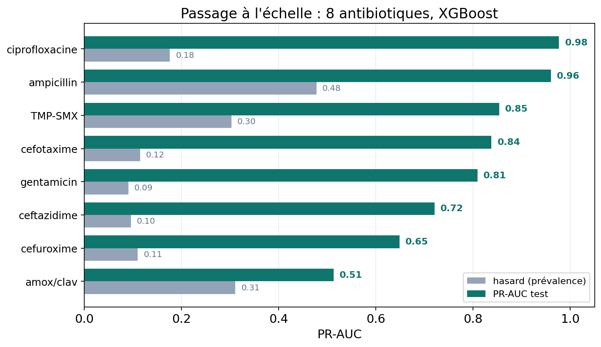{width=100%}
:::
::: {.column width="42%"}
### Le pipeline

- `run_antibiotic_pipeline(atb, data)` — mêmes modèles, même protocole.
- Un artefact `.joblib` sauvegardé par ATB.

### Les résultats (test)

- cipro **0,98** · ampicilline **0,96** · TMP-SMX **0,85**
- cefotaxime **0,84** · gentamicine **0,81** · ceftazidime **0,72**
- cefuroxime **0,65** · amox/clav **0,51**
- Tous au-dessus du hasard, gains **très inégaux**.
:::
:::

::: {.notes}
Ce run de référence couvre 8 ATB. Le notebook permet de relancer la boucle sur les 9 ATB stricts. Les écarts avec l'exploration manuelle de cefuroxime (0,649 vs 0,665) viennent des hyperparamètres propres au pipeline et du seuil : il faut les lire comme ±0,02, pas comme deux vérités différentes.
:::

## Ce que le classement nous apprend

### La performance suit la biologie de la résistance

- **Facile** : mutations ponctuelles ciblées — fluoroquinolones, ampicilline → **0,96–0,98**.
- **Moyen** : bêta-lactamines à spectre étendu, aminoglycosides → **0,72–0,85**.
- **Difficile** : amoxicilline/acide clavulanique → **0,51**, à peine mieux que le hasard (0,31).

### La prévalence n'explique pas tout

- Amox/clav : **31 %** de résistants, mais un PR-AUC de 0,51.
- Ciprofloxacine : **18 %** de résistants, PR-AUC de 0,98.
- Ce qui change : la **génétique de la résistance** (SNP ciblés vs mécanismes multiples).

### Conséquence

> Choisir l'antibiotique n'est pas un détail technique : c'est **formuler le problème**.

::: {.notes}
C'est le résultat le plus intéressant du passage à l'échelle. On pourrait croire qu'un ATB avec beaucoup de résistants est plus facile : c'est faux. Les bêta-lactamines à large spectre combinent plusieurs mécanismes (bêta-lactamases, porines, efflux), souvent plasmidiques et mal capturés par une matrice de présence/absence.
:::

## Limites

- **Test petit** : 656 génomes, 72 résistants → intervalles de confiance larges.
- **Split groupé par lignée**, pas par phylogénie fine.
- **Pas de validation externe** sur une autre cohorte ou un autre pays.
- **Seuil choisi et mesuré sur la validation** → estimation optimiste.
- **Calibration explorée, non corrigée** (Platt / isotonic).
- **Deep learning** : une architecture, un seed, meilleur epoch = 1.
- **Co-résistance** : SHAP met en avant `parC` / `gyrA` pour une céphalosporine → risque de marqueurs de lignage.
- **Phénotypes hétérogènes** entre études (méthodes de laboratoire différentes).

::: {.notes}
Il faut présenter ces limites avant les perspectives : elles conditionnent ce qu'on peut affirmer. En particulier, le seuil optimisé sur la validation puis appliqué au test reste une estimation optimiste tant qu'on ne fait pas de validation croisée imbriquée.
:::

## Perspectives

### Consolider la mesure

- Validation croisée groupée à 5 folds, plusieurs seeds, **bootstrap** pour les IC.
- **Validation externe** et seuil figé évalué sur le test.
- **Recalibration** (Platt / isotonic) intégrée à la décision.

### Améliorer le signal

- Modèle **multi-tâches** : partager l'information entre les 48 ATB.
- Features biologiques ciblées : **bêta-lactamases, porines, pompes d'efflux**, plasmides.
- Annotation des clusters inconnus (`MFCAOJAD_04228`, `Cluster_7843`…).

### Rendre l'outil utilisable

- Prédiction à partir d'un génome, avec **abstention** hors domaine de validité.
- Restituer la **probabilité calibrée** et les variables contributives, pas seulement R/S.

::: {.notes}
La piste multi-tâches est probablement la plus prometteuse : les ATB partagent des mécanismes et des lignées, donc un modèle joint peut mieux apprendre les ATB rares. C'est aussi une réponse directe au problème des 34 ATB exclus.
:::

## Conclusion

### Ce que l'on retient

- **48 ATB → 9 exploitables** en critère strict : la couverture et la prévalence sont des filtres décisifs.
- Un pipeline **reproductible** : une cellule change l'antibiotique, tout le reste est identique.
- **Cefuroxime** : XGBoost et L1 atteignent **0,65–0,69** de PR-AUC en validation, **0,665** en test, contre **0,110** au hasard.
- Le signal est **concentré** (21 variables L1), mais partiellement de la **co-résistance**.
- Le **deep learning** n'apporte pas de gain : MLP 0,62–0,64 de PR-AUC.
- La performance varie de **0,51 à 0,98** selon l'antibiotique : la cible compte autant que le modèle.

> Le bon modèle n'est pas le plus complexe : c'est celui qui capture un signal biologique réel, généralise sur des lignées non vues et sait dire **ce qu'il ne sait pas**.

::: {.notes}
La conclusion reprend les quatre temps de la présentation. Le fil rouge : un modèle utile suppose une cible bien choisie, une évaluation honnête et une interprétation biologique prudente.
:::

## Questions

### Merci de votre attention

- Notebook : `notebooks/all_antibiotic.ipynb`
- Pipeline : `src/pipeline.py`
- Rapports : `reports/coverage_by_atb.csv`, `reports/summary_by_atb.csv`
- Présentation générée avec **Quarto + Reveal.js**

::: {.notes}
Les figures de cette présentation sont issues directement des sorties du notebook (couverture, L1, SHAP, MLP) et des rapports CSV du run de référence.
:::
