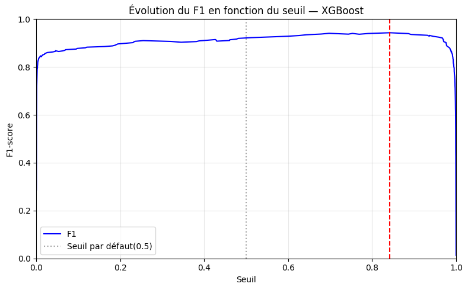
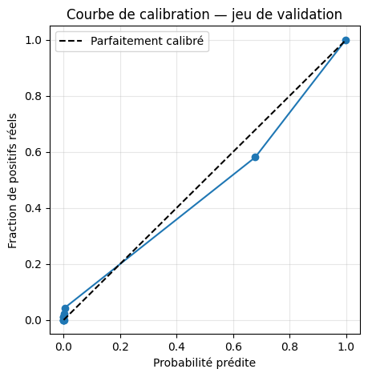
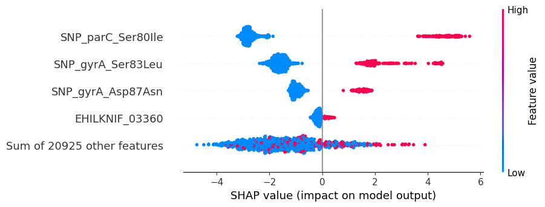
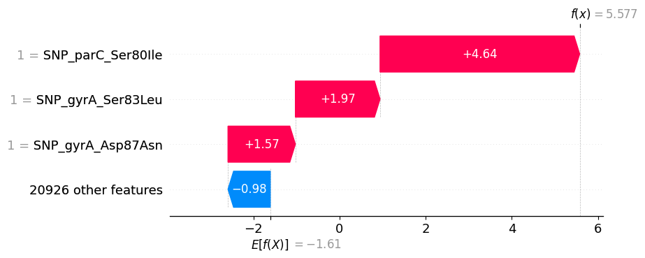
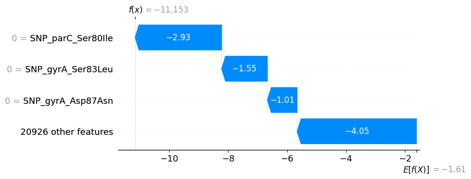
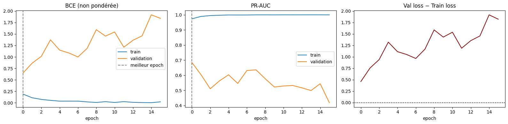
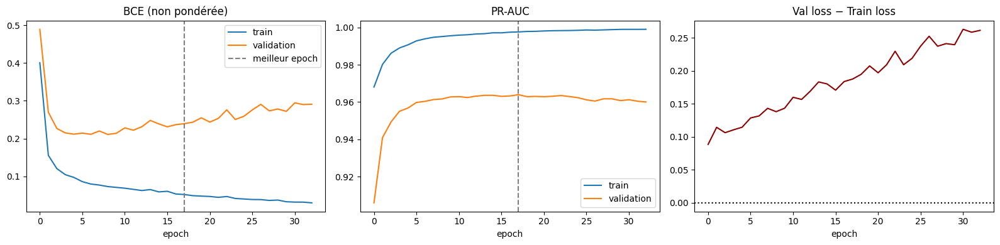

## Contexte

### Un problème de santé publique

- *Escherichia coli* : pathogène majeur, nombreuses résistances.
- **Ciprofloxacine** : fluoroquinolone largement utilisée.
- La résistance est en partie portée par des **mutations ponctuelles** connues.

### Objectif du projet

> Prédire le phénotype **sensible / résistant** à partir du génotype, avec un modèle **utile, interprétable et honnêtement évalué**.

::: {.notes}
Le projet ne consiste pas seulement à maximiser une accuracy. Il faut aussi éviter la fuite de clones, choisir les bonnes métriques et interpréter biologiquement les résultats.
:::

## Données utilisées

### Ce que charge le notebook

- Matrice préparée : `data/processed/ecoli_ciprofloxacin_snp.parquet`.
- Splits : `data/splits_snp_3way/`.
- **5 935 isolats × 20 929 features** (20 933 colonnes avec la cible et les métadonnées) :
  - 20 731 gènes / clusters pangénomiques ;
  - 198 SNP QRDR et régulateurs.

### La cible `y`

| Valeur | Signification |
|---:|---|
| `0` | sensible à la ciprofloxacine |
| `1` | résistant |

- 1 285 résistants sur 5 935 isolats (**21,7 %**).

::: {.notes}
Le notebook ne reconstruit ni la matrice ni la cible : il part des fichiers déjà préparés. La construction des SNP et des splits est documentée dans les scripts `src/add_qrdr_snps.py` et `src/make_3way_splits_snp.py`.
:::

## Splits : éviter la fuite de lignage

### Le piège du split aléatoire

- Un split aléatoire plaçait **95,8 %** des isolats de test dans un groupe MLST déjà vu dans le train.
- Le modèle pouvait apprendre des **marqueurs de clones** plutôt que la résistance.

### Split 3-way groupé

- `StratifiedGroupKFold` à 6 folds.
- 4 folds train / 1 validation / 1 test.
- Aucun groupe MLST dans deux splits ; `unknown` traité à part.

| Split | Isolats | Résistants | Taux R |
|---|---:|---:|---:|
| Train | 4 074 | 975 | 23,9 % |
| Validation | 932 | 156 | 16,7 % |
| Test | 929 | 154 | 16,6 % |

::: {.notes}
Le déséquilibre train/validation/test est inhérent aux grands groupes MLST. Il faut utiliser PR-AUC, recall, F1 et balanced accuracy.
:::

## Modèles testés

### Quatre familles

**Régression logistique** · **Random Forest** · **XGBoost** · **MLP PyTorch**

### Protocole

- Mêmes splits, mêmes features, mêmes métriques.
- Seuil par défaut : 0,5, puis seuil optimisé sur la validation (F1 max).
- Métriques : **PR-AUC**, **recall résistant**, **F1 résistant**, **balanced accuracy**.

### Pourquoi pas l'accuracy seule ?

> Le baseline « tout sensible » donne déjà **83,3 %** en validation et **83,4 %** en test.

## Résultats sur le split groupé

### Modèles classiques (20 929 features, seuil 0,5)

| Modèle | PR-AUC train | PR-AUC val | PR-AUC test | Recall R val | Recall R test |
|---|---:|---:|---:|---:|---:|
| LogReg | 1,000 | 0,554 | 0,830 | 0,314 | 0,669 |
| Random Forest | 1,000 | 0,803 | 0,833 | 0,385 | 0,604 |
| **XGBoost** | 1,000 | **0,969** | **0,951** | **0,917** | **0,916** |

### Lecture

- Les trois modèles atteignent **100 % sur le train**.
- Mais seul XGBoost garde un très bon niveau en validation **et** en test.
- LogReg et Random Forest prédisent surtout la classe majoritaire.

::: {.notes}
Le recall résistant est la métrique critique : manquer un résistant peut être plus grave que sur-prédire une résistance. Au seuil optimisé 0,842, XGBoost obtient un recall test de 0,909 et un F1 de 0,940.
:::

## Résultats détaillés — validation à 0,5 {.small}

### Toutes les métriques, seuil 0,5

| Modèle | Accuracy | Bal. acc | Precision | Recall R | F1 R | ROC-AUC | PR-AUC |
|---|---:|---:|---:|---:|---:|---:|---:|
| LogReg | 0,845 | 0,633 | 0,570 | 0,314 | 0,405 | 0,844 | 0,554 |
| Random Forest | 0,897 | 0,692 | 1,000 | 0,385 | 0,556 | 0,939 | 0,803 |
| **XGBoost** | **0,974** | **0,951** | 0,929 | **0,917** | **0,923** | **0,986** | **0,969** |

### Lecture

- Random Forest a une précision parfaite… mais ne rappelle que **38,5 %** des résistants.
- XGBoost est le seul modèle **équilibré** entre précision et rappel.
- LogReg et RF sont piégés par le déséquilibre (16,7 % de résistants en validation).

::: {.notes}
Ces chiffres correspondent au notebook d'exploration (validation, seuil 0,5). Le rappel est la métrique critique : un faux négatif est un résistant prédit sensible.
:::

## Sur-apprentissage : oui, mais lequel ?

### Les modèles complets font 100 % sur le train

Avec 20 929 features pour 4 074 échantillons, les modèles peuvent mémoriser le train.

### Ce qui compte : l'écart train → validation/test

| Modèle | Écart train → val (PR-AUC) | Diagnostic |
|---|---:|---|
| LogReg complet | 1,000 → 0,554 | fort sur-apprentissage / sous-ajustement de la classe R |
| Random Forest complet | 1,000 → 0,803 | sur-apprentissage modéré |
| XGBoost complet | 1,000 → 0,969 | bonne généralisation |
| LogReg SNP seuls | 0,983 → 0,961 | très stable |
| Pangénome seul | 1,000 → 0,512 | sur-apprentissage marqué |
| MLP complet | ≈ 1,000 → 0,685 | sur-apprentissage rapide |
| MLP top-50 SHAP | ≈ 1,000 → 0,964 | écart maîtrisé |

> Le sur-apprentissage se diagnostique par l'écart train → validation/test, pas par le score de train seul.

## Le signal vient surtout des SNP

### Comparaison des représentations

| Modèle | Features | PR-AUC val | PR-AUC test | Recall R val | Recall R test |
|---|---|---:|---:|---:|---:|
| LogReg | 198 SNP | **0,961** | **0,941** | **0,910** | **0,942** |
| XGBoost | 198 SNP | 0,948 | 0,922 | 0,936 | 0,942 |
| XGBoost | 20 929 | 0,969 | 0,951 | 0,917 | 0,916 |
| LogReg | 20 731 gènes | 0,512 | 0,775 | 0,308 | 0,656 |
| XGBoost | 20 731 gènes | 0,579 | 0,810 | 0,372 | 0,643 |

### Conclusion

- Le **pangénome seul** contient du bruit et des marqueurs de lignage.
- Les **198 SNP** suffisent à obtenir l'essentiel de la performance.
- XGBoost complet n'apporte qu'un gain marginal par rapport à une régression logistique SNP-only.

::: {.notes}
C'est un résultat important : le modèle le plus simple est presque aussi performant que le modèle complet. Il est aussi plus interprétable.
:::

## Du score à la décision : choisir le seuil {.small}

::: {.columns}
::: {.column width="55%"}
{width=100%}
:::
::: {.column width="45%"}
### XGBoost — validation

- Seuil qui maximise le F1 : **0,842**.
- F1 : **0,923 → 0,943**.
- Accuracy : 0,974 → **0,982**.
- Faux positifs : **11 → 2**.
- Faux négatifs : **13 → 15**.

### Prudence

- Seuil choisi **et** évalué sur la validation → estimation **optimiste**.
- Il est maintenant **figé puis évalué sur le test** : F1 **0,940**, recall **0,909**, 4 faux positifs, 14 faux négatifs.
- Une validation croisée imbriquée resterait plus rigoureuse pour estimer le seuil.
:::
:::

::: {.notes}
Le plateau du F1 est large entre 0,2 et 0,9 : le choix exact du seuil est moins important que l'ordre de grandeur. En revanche, le seuil 0,5 n'est pas optimal pour le F1.
:::

## Calibration des probabilités — XGBoost {.small}

::: {.columns}
::: {.column width="45%"}
{width=100%}
:::
::: {.column width="55%"}
### Lecture

- Courbe proche de la diagonale : les probabilités sont **globalement fiables**.
- Légère **sous-confiance** dans les hautes probabilités.
- Brier score validation : **0,020** pour XGB, contre 0,133 (LogReg) et 0,082 (RF).

### Pourquoi c'est important

- Un seuil n'a de sens que si les probabilités sont calibrées.
- La calibration se travaille séparément de la discrimination (PR-AUC).
:::
:::

::: {.notes}
La calibration ne change pas le classement des individus, donc pas le PR-AUC. Elle change l'interprétation clinique des probabilités et le choix du seuil.
:::

## Interprétation biologique — SHAP {.small}

::: {.columns}
::: {.column width="56%"}
{width=100%}
:::
::: {.column width="44%"}
### Top features XGBoost (SHAP moyen)

| Feature | SHAP moyen |
|---|---:|
| `SNP_parC_Ser80Ile` | 3,07 |
| `SNP_gyrA_Ser83Leu` | 1,77 |
| `SNP_gyrA_Asp87Asn` | 1,07 |
| `EHILKNIF_03360` | 0,18 |

### Ce que cela signifie

- Le modèle s'appuie d'abord sur des mutations **connues** de résistance aux fluoroquinolones.
- C'est **biologiquement rassurant**.
- Les autres features sont individuellement faibles ; elles peuvent porter des marqueurs de lignage ou des gènes accessoires.
:::
:::

::: {.notes}
SHAP est calculé sur le test. Les trois SNP QRDR dominent très largement les contributions individuelles. La somme des 20 925 autres features reste notable (10,18), mais chaque feature prise séparément a un effet marginal.
:::

## Analyse d'erreurs — XGBoost au seuil 0,842 {.small}

::: {.columns}
::: {.column width="50%"}
### Faux positif (prédit R, réel S)

{width=100%}

- Porte les **trois mutations canoniques**.
- Pourtant phénotypé sensible → phénotype à vérifier, mécanisme compensateur ou résistance non exprimée.
:::
::: {.column width="50%"}
### Faux négatif (prédit S, réel R)

{width=100%}

- **Aucune** des trois mutations canoniques.
- Résistance probablement portée par un autre mécanisme : pompe d'efflux, plasmide, membrane.
:::
:::

> 4 faux positifs et 14 faux négatifs sur 929 isolats de test.

::: {.notes}
L'analyse d'erreurs est biologiquement lisible : le modèle rate les résistances qui ne passent pas par les mutations QRDR canoniques. Les faux positifs peuvent aussi révéler des phénotypes discordants ou des mécanismes compensateurs.
:::

## Deep learning : ce qui a été testé {.small}

### Deux variantes de MLP

- **Sans sélection** : les **20 929 features** brutes.
- **Avec sélection** : les **top 50 features** par importance SHAP moyenne, calculées avec XGBoost **sur le train**.

### Architectures et entraînement

- Brut : `20 929 → 512 → 128 → 32 → 1`, BatchNorm, ReLU, dropout 0,3 / 0,2.
- Top-50 : `50 → 64 → 16 → 1`, ReLU, dropout 0,5.
- AdamW (`lr = 0,001`), batch 64, `BCEWithLogitsLoss` pondérée (`pos_weight ≈ 3,18`).
- Early stopping sur le **PR-AUC de validation** (patience 15).

### Pourquoi ces baselines ?

- Même représentation que XGBoost pour la version brute → comparaison directe.
- La version top-50 teste l'effet d'une représentation compacte.
- Objectif : mesurer l'apport réel du réseau, pas seulement son meilleur score.

::: {.notes}
Le MLP brut sert de point de comparaison. La variante top-50 réutilise la sélection SHAP issue de XGBoost : elle mesure donc l'effet de la représentation autant que celui de l'architecture.

Non retenus pour l'instant : CNN (données non séquentielles), modèle de fondation (surdimensionné pour 5 935 échantillons), autoencodeur (piste de réduction de dimension).
:::

## MLP complet : entraînement et sur-apprentissage {.small}

::: {.columns}
::: {.column width="62%"}
{width=100%}
:::
::: {.column width="38%"}
### Early stopping

- Meilleur epoch : **0**.
- Meilleur PR-AUC validation : **0,685**.
- Arrêt à l'epoch **15**.

### Diagnostic

- PR-AUC train → **≈ 1,0**.
- PR-AUC validation plafonne à **0,685**.
- Écart de loss croissant → **sur-apprentissage rapide**.
:::
:::

::: {.notes}
Le meilleur epoch est le tout premier : le réseau mémorise immédiatement le train puis se dégrade. Le dropout, la pondération et l'early stopping limitent les dégâts, mais ne suffisent pas à combler l'écart avec XGBoost.
:::

## MLP complet : résultats {.small}

### Validation (seuil 0,5) et test (seuil optimisé)

| Jeu | Seuil | Accuracy | Bal. acc | Precision | Recall R | F1 R | ROC-AUC | PR-AUC |
|---|---:|---:|---:|---:|---:|---:|---:|---:|
| Validation | 0,50 | 0,770 | 0,780 | 0,405 | **0,795** | 0,537 | 0,860 | 0,685 |
| Test | 0,776 | 0,899 | 0,825 | 0,688 | 0,714 | 0,701 | 0,882 | **0,730** |

### Lecture

- À 0,5, le MLP privilégie le **rappel** (79,5 %) au prix de **182 faux positifs**.
- Le seuil 0,776 rétablit l'équilibre, mais le F1 test plafonne à **0,701**.
- Le signal est appris (PR-AUC 0,730, contre 0,166 de prévalence), mais loin de XGBoost.

::: {.notes}
Le seuil du MLP est choisi sur la validation puis appliqué au test : c'est le protocole correct. Le PR-AUC test de 0,730 reste très au-dessus du hasard (0,166), donc le réseau apprend bien quelque chose, mais il est nettement derrière XGBoost.
:::

## MLP + sélection de variables {.small}

::: {.columns}
::: {.column width="58%"}
{width=100%}
:::
::: {.column width="42%"}
### Protocole

- Top 50 features par importance SHAP moyenne, calculées avec XGBoost **sur le train**.
- Architecture : `50 → 64 → 16 → 1`, dropout 0,5, AdamW.

### Résultats

- Meilleur epoch : **17** ; PR-AUC validation : **0,964**.
- Validation (0,5) : F1 **0,902**.
- Test (seuil 0,960) : PR-AUC **0,954**, F1 **0,943**, recall **0,909**.
:::
:::

> Le MLP rattrape XGBoost… mais la sélection top-50 est déjà supervisée par XGBoost.

::: {.notes}
Ce n'est pas une victoire indépendante du deep learning : c'est la preuve que la représentation (50 features) porte l'essentiel du signal. Le réseau exploite très bien une matrice compacte, mais il ne découvre pas seul les bonnes variables.
:::

## XGBoost vs MLP : le verdict

### Comparaison sur le test

| Modèle | Features | Seuil | PR-AUC | Recall R | F1 R | Bal. acc |
|---|---|---:|---:|---:|---:|---:|
| **XGBoost** | 20 929 | 0,842 | **0,951** | **0,909** | **0,940** | **0,952** |
| MLP brut | 20 929 | 0,776 | 0,730 | 0,714 | 0,701 | 0,825 |
| MLP top-50 SHAP | 50 | 0,960 | **0,954** | **0,909** | **0,943** | **0,953** |

### Écarts

- MLP brut vs XGBoost : **−22,1 pts** de PR-AUC, **−23,9 pts** de F1, **−12,7 pts** de balanced accuracy.
- MLP top-50 vs XGBoost : **+0,3 pt** de PR-AUC, **+0,3 pt** de F1 → quasi-identique.
- Le MLP brut reste compétitif en rappel (0,714), mais avec beaucoup de faux positifs.

> Sur la représentation brute, le deep learning n'apporte pas de gain. Avec 50 features sélectionnées par XGBoost, il rattrape la référence.

::: {.notes}
Les écarts importants du MLP brut sont cohérents avec la littérature sur les données tabulaires de petite taille. Le résultat top-50 est excellent, mais il faut rappeler que la sélection des variables utilise déjà le modèle XGBoost.
:::

## Ce que le deep learning apporte pédagogiquement {.small}

### Compétences travaillées

- Passage de scikit-learn à PyTorch : tenseurs, loss, optimiseur, epochs.
- Gestion du sur-apprentissage : dropout, BatchNorm, early stopping.
- Déséquilibre : `pos_weight`, seuil, PR-AUC.
- Sélection de features par SHAP et comparaison de représentations.
- Rigueur : mêmes splits, mêmes métriques.

### Message scientifique

> “Sur les 20 929 features brutes, le MLP plafonne à 0,730 de PR-AUC test, contre 0,951 pour XGBoost. Avec 50 features sélectionnées par SHAP, il remonte à 0,954 : la représentation compte plus que l'architecture.”

C'est un **résultat négatif nuancé** : le ML classique reste la référence sur la matrice brute ; le DL devient compétitif quand on lui fournit une représentation compacte, mais la sélection est elle-même supervisée par XGBoost.

## Limites

- **Test petit** : 929 isolats, 154 résistants → intervalles de confiance larges.
- **Split groupé par MLST**, pas par phylogénie fine.
- **Pas de validation externe** sur une autre cohorte.
- **Seuil optimal (0,842) choisi sur la validation**, puis évalué sur le test (F1 0,940) ; la sélection du seuil reste optimiste, une validation croisée imbriquée serait préférable.
- **Calibration** explorée mais non corrigée (Platt / isotonic).
- **Deep learning** : deux architectures, mais un seul seed ; la variante top-50 dépend d'une sélection SHAP issue de XGBoost.
- **Features pangénomiques** partiellement non annotées ; risque de marqueurs de lignage.
- **Analyse d'erreurs** réalisée (4 faux positifs, 14 faux négatifs), mais confrontation systématique à la littérature encore à approfondir.

::: {.notes}
Il faut présenter les résultats avec des intervalles de confiance et éviter de conclure sur des différences de 1 ou 2 points.
:::

## Perspectives

### Pour consolider les résultats

- Validation croisée groupée à 5 folds, plusieurs seeds, IC par bootstrap.
- Validation externe.
- Validation croisée imbriquée pour le seuil **et** la sélection de features.
- Correction de la calibration (Platt / isotonic) et intégration dans la décision.
- Analyse d'erreurs par lignage, confrontation à la littérature.

### Pour aller plus loin

- Ajouter d'autres mécanismes : pompes d'efflux, plasmides, gènes acquis.
- Features SNPs + gènes ; MLP sur les 198 SNP, sélection sans XGBoost, autoencodeur.
- Tester la stabilité du top-50 SHAP (seeds, bootstrap).
- CNN sur séquences brutes, si les données le permettent.

## Conclusion {.small}

### Ce que l'on retient

- Le jeu enrichi contient **5 935 × 20 929 features**, dont **198 SNP QRDR**.
- Un split **groupé par MLST** évite la fuite de clones.
- **XGBoost** obtient les meilleures performances globales (**PR-AUC test 0,951**, F1 0,940 au seuil 0,842).
- Une **régression logistique sur 198 SNP** est presque aussi bonne, plus simple et plus interprétable.
- Le **pangénome seul** sur-apprend et généralise moins bien.
- Le seuil **0,842** améliore le F1 en validation (0,923 → 0,943) ; les probabilités sont **globalement calibrées** (Brier 0,020).
- Le **MLP brut** reste loin derrière (PR-AUC test **0,730**), mais le **MLP top-50 SHAP** atteint **0,954** : la représentation est décisive.
- Les **erreurs sont interprétables** : faux négatifs sans mutation QRDR, faux positifs portant les trois mutations canoniques.

### Message final

> Le bon modèle n'est pas le plus complexe : c'est celui qui capture le signal biologique, généralise sur des lignages non vus et reste interprétable. Ici, la représentation — 198 SNP ou 50 features SHAP — compte plus que la famille de modèle.

## Questions

### Merci de votre attention

- Des questions ?
- Les notebooks, scripts et documents sont disponibles dans le projet.
- Présentation générée avec **Quarto + Reveal.js**.
